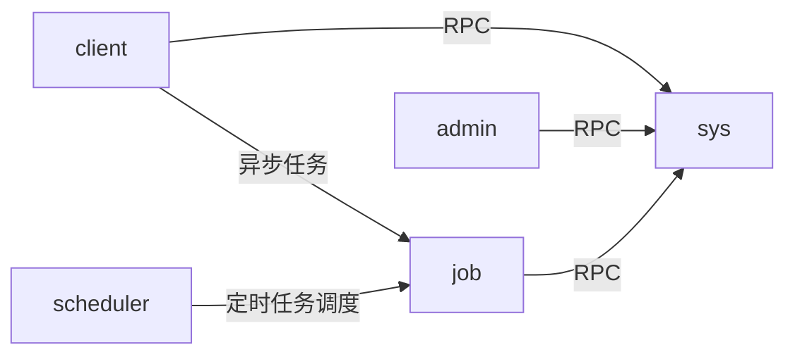

#### 当前目录说明

当前是基础项目分类，如果后续新增项目，那么需要更新表格记录项目用途。

| 项目名称  | 名称         | 功能                             |
| --------- | ------------ | -------------------------------- |
| client    | 客户端       | 提供用户API                      |
| admin     | 后台管理     | 提供管理员后台API                |
| sys       | 系统核心服务 | 作为内部多端调用的核心服务       |
| scheduler | 定时调度服务 | 提供后端系统定时任务的能力       |
| job       | 任务服务     | 提供定时任务或异步事件的代码注册 |

#### 依赖流程图

